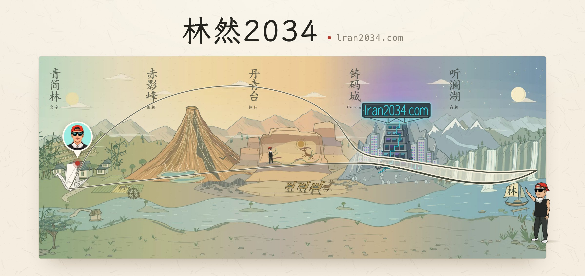
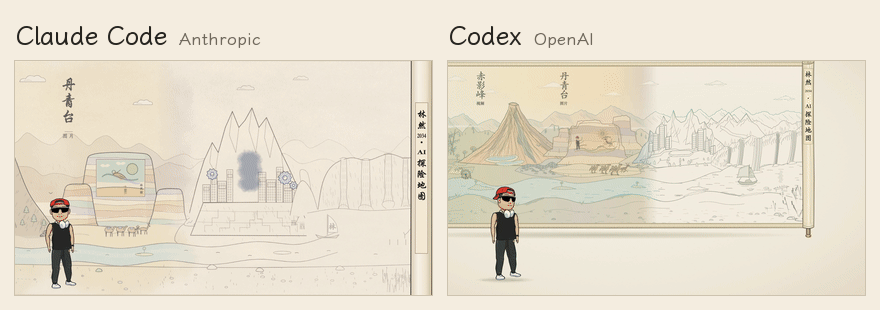

<picture>
  <source media="(prefers-color-scheme: dark)" srcset="https://raw.githubusercontent.com/lran2034/lran2034/main/assets/lran2034-banner-dark.jpg">
  
</picture>

  <b>AI Explorer — documenting the AI world and hands-on practice, one step at a time</b> 
  <a href="https://github.com/lran2034">中文</a> · English

I'm 林然2034 (lran2034). The five lands on the map are the five directions I'm exploring: **Bamboo Scroll Forest** (writing), **Red Shadow Peak** (video), **Painted Terrace** (images), **Code Foundry** (coding) and **Listening Lake** (audio).

## One storyboard, two AIs, two films

<picture>
  <source type="image/webp" srcset="https://raw.githubusercontent.com/lran2034/lran2034/main/assets/lran2034-claude-vs-codex.webp">
  
</picture>

Promo film, 0:55–1:03 · Code Foundry: <code>lran.build(2034)</code> is typed, the tower rises, and the sign lights up as lran2034.com

The 100-second promo film exists in two versions, and **every frame is drawn by code**:

| Part | Who / how |
|---|---|
| Storyboard and direction | Me |
| Code | Left: Claude Code · Right: Codex |
| Visuals | SVG (ink lines with light washes) drawn in TypeScript, recorded frame by frame, assembled with FFmpeg |
| The character | Drawn as vector art in code by Codex from my photo, shared by both versions |
| Music, sound effects, subtitles | Generated by code |
| Voice-over | Jianying (CapCut China) text-to-speech, "Sunny Male" voice |

---

Map, character, avatar and film frames © 林然2034. All rights reserved; please don't reuse without permission. Title font: LXGW WenKai (SIL OFL 1.1).
