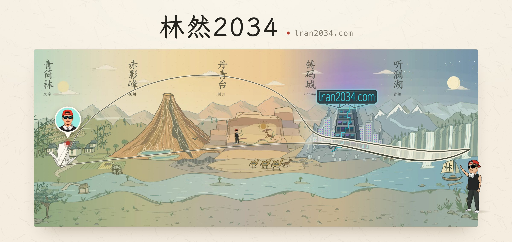
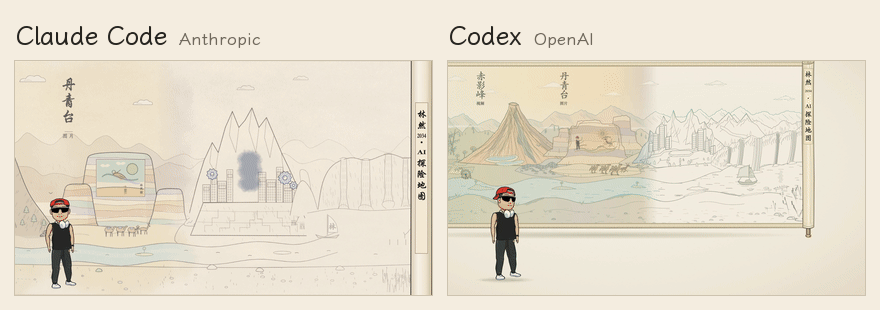

<picture>
  <source media="(prefers-color-scheme: dark)" srcset="https://raw.githubusercontent.com/lran2034/lran2034/main/assets/lran2034-banner-dark.jpg">
  
</picture>

  <b>AI探险家｜一路记录我看到的AI世界与实战</b> 
  中文 · <a href="https://github.com/lran2034/lran2034/blob/main/README.en.md">English</a>

我是林然2034。地图上的五块大陆，是我正在探索的五个方向：**青简林**（文字）、**赤影峰**（视频）、**丹青台**（图片）、**铸码城**（Coding）、**听澜湖**（音频）。

## 同一份分镜，两个 AI 各写了一版

<picture>
  <source type="image/webp" srcset="https://raw.githubusercontent.com/lran2034/lran2034/main/assets/lran2034-claude-vs-codex.webp">
  
</picture>

《林然2034·AI探险地图》第 55–63 秒 · 铸码城：敲下 <code>lran.build(2034)</code>，城楼搭起，招牌亮成 lran2034.com

这部 100 秒的宣传片有两个版本，**每一帧都是代码画出来的**：

| 环节 | 谁来做 / 怎么做 |
|---|---|
| 分镜和要求 | 我 |
| 写代码 | 左：Claude Code · 右：Codex |
| 画面 | TypeScript 画的 SVG（墨线加淡彩），程序逐帧录制，FFmpeg 合成 |
| 林然的造型 | Codex 按照片用代码画成矢量图，两版共用 |
| 配乐、音效、字幕 | 代码生成 |
| 配音 | 剪映「阳光男声」朗读 |

---

地图、角色形象、头像和宣传片画面 © 林然2034，保留所有权利，未经许可请勿使用。标题字体：霞鹜文楷 LXGW WenKai（SIL OFL 1.1）。
